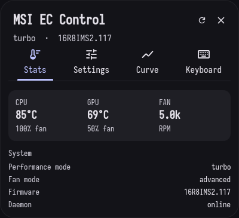
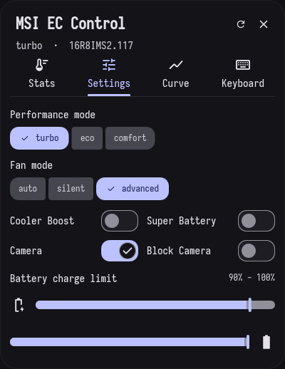
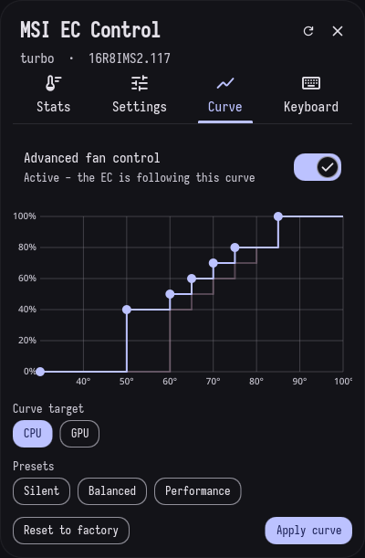
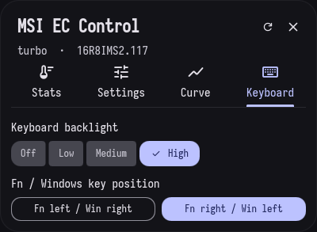

# Dank Fan Stats

Dank Material Shell widget for MSI laptops running the [`msi-ec`](https://github.com/BeardOverflow/msi-ec)
kernel driver. Shows fan RPM / temperatures on the Dank bar and opens a control
menu to drive every writable MSI EC option.

## Screenshots

| Stats | Settings |
| :---: | :---: |
|  |  |
| **Live telemetry and a system summary** | **Performance / fan modes, toggles, and battery charge limit** |

| Curve | Keyboard |
| :---: | :---: |
|  |  |
| **Draggable advanced fan curve with presets** | **Backlight level and Fn / Windows key swap** |

## What it does

- Root daemon reads fan RPM from the EC (via read-only `ec_sys`) and the rest
  from the `msi-ec` sysfs platform device.
- Writes widget data to `/run/dank-fan-stats/stats.json`.
- Exposes a control FIFO at `/run/dank-fan-stats/control`.
- Click the bar pill to open the tabbed control menu (**Stats / Settings / Curve / Keyboard**):

  | Control | MSI EC attribute |
  | :--- | :--- |
  | Performance mode (eco / comfort / sport / turbo) | `shift_mode` |
  | Fan mode (auto / silent / basic / advanced) | `fan_mode` |
  | Cooler Boost | `cooler_boost` |
  | Super Battery | `super_battery` |
  | Webcam / Block Webcam | `webcam`, `webcam_block` |
  | Fn / Windows key position | `fn_key`, `win_key` |
  | Keyboard backlight (off / low / medium / high) | LED `msiacpi::kbd_backlight` |
  | Battery charge start / stop | `charge_control_start_threshold`, `charge_control_end_threshold` |

- Tabs: **Stats** (live telemetry + system summary), **Settings** (modes, toggles,
  battery charge limit), **Curve** (draggable fan-curve editor with CPU/GPU target
  and Silent / Balanced / Performance presets), **Keyboard** (backlight level +
  Fn/Win swap).
- The keyboard backlight is a standard kernel LED class device, so it is set by
  writing `brightness` - no raw EC access needed.
- Right-click the pill to quick-toggle Cooler Boost.
- The **Curve** tab has a draggable **fan-curve editor** that programs the
  MSI EC advanced curve (seven fan levels, six temperature thresholds) for CPU
  and GPU, with Silent / Balanced / Performance presets.

## Fan curve (advanced control)

The "advanced" fan mode uses a table stored in raw EC memory with no `msi-ec`
sysfs interface, so it is programmed the same way MControlCenter does it:

- CPU temperatures `0x6A-0x6F`, CPU fan levels `0x72-0x78`
- GPU temperatures `0x82-0x87`, GPU fan levels `0x8A-0x90`
- fan mode register `0xD4` (`auto` `0x0D`, `advanced` `0x8D`)

Reads work with read-only `ec_sys`; **writes require `ec_sys write_support=1`**
(installed to `/etc/modprobe.d/ec_sys.conf`). The debugfs node stays root-only,
so only the daemon can write it. Curves are validated (0-100, strictly ascending
temperatures, non-decreasing levels) before anything is written.

## Files

Root service files (`Service/`):

- `install.sh`
- `dank-fan-stats.service`
- `dank-fan-stats-daemon.sh`
- `ec_sys.conf` (loads `ec_sys` for real fan RPM)
- `ec_sys-write.conf` (enables raw EC writes for the fan curve)

Dank Material Shell plugin files (repo root):

- `plugin.json`
- `DankFanStats.qml`
- `DankFanStatsSettings.qml`

## Install

```bash
sudo ~/.local/share/dank-fan-stats/Service/install.sh
```

The installer:

1. Installs the daemon to `/usr/local/bin/dank-fan-stats-daemon`.
2. Installs and enables `dank-fan-stats.service` (client user auto-detected).
3. Loads `ec_sys` for fan RPM and enables `write_support=1` so the advanced fan curve can be programmed.
4. Reloads `ec_sys` so the new parameter takes effect.

## Check

```bash
systemctl status dank-fan-stats.service
cat /run/dank-fan-stats/stats.json
```

## Control FIFO commands

```text
set shift_mode <eco|comfort|sport|turbo>
set fan_mode <auto|silent|basic|advanced>
set cooler_boost <on|off|toggle>
set super_battery <on|off|toggle>
set webcam <on|off|toggle>
set webcam_block <on|off|toggle>
set fn_key <left|right>
set win_key <left|right>
set charge_start <0-100>
set charge_end <0-100>
set fan_curve <6 cpu temps> <7 cpu levels> <6 gpu temps> <7 gpu levels>
set advanced <on|off>
set kbd_backlight <0-3>
refresh
```

`fan_curve` arguments are comma separated integers, for example:

```text
set fan_curve 50,60,65,70,75,80 0,40,50,60,70,80,85 50,60,65,70,75,80 0,40,50,60,70,80,85
```

Values are validated against the driver's `available_*` lists before writing.

## Reload DMS

```bash
dms ipc call plugins reload dankFanStats
```

## Resources

- MSI EC - https://github.com/BeardOverflow/msi-ec
- DankMaterialShell - https://github.com/AvengeMedia/DankMaterialShell
